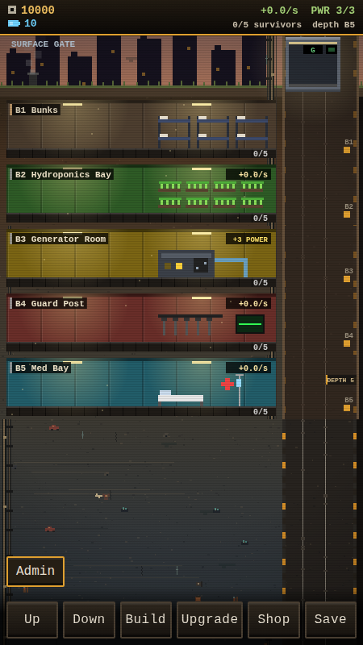

# Tiny Bunker

A small Fallout Shelter-style bunker manager that runs in the browser (plain HTML, CSS and ES modules, no build step).
Serve the folder with any static server (e.g. `python3 -m http.server`) and open `index.html`.

## How to play
- Ferry refugees down the elevator (drag on the shaft, hold Up/Down, or use W/S and the arrow keys). Each delivery earns a tip and a new survivor.
- Dig new floors: residential floors house survivors, commercial floors earn scrap, and Energy rooms power them.
- Spend batteries on hoist upgrades, choosing floor types and rushing builds.
- Spin the lucky wheel in the Shop every 15 minutes.

## Shortcuts
B Build, U Upgrade, H Shop, Esc close menu.

## Features
- Autosave every 10 seconds, plus offline earnings (50% of income, up to 8 hours).
- Scavenger salvage bonuses every 45-90 seconds while the bunker is earning.
- Day and night sky, drifting clouds, floating dust, work and sleep icons, and dimmed unpowered rooms.
- Seeded, depth-aware underground strata, buried finds, bunker infrastructure, and digging effects.
- Admin tools are available only with `?admin` in the URL (client-side only, not secure).

## Screenshot

